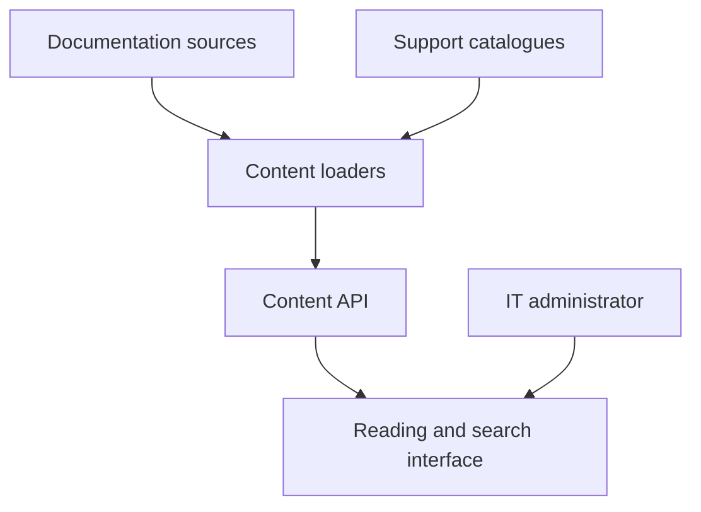

# Support SI Admin — IT Documentation Portal — Architecture

Administrators can find an operating procedure, understand an application, follow a tutorial or locate a reusable prompt without navigating several disconnected documentation sources. Platform documentation stays connected to its maintained source files.

## Components

| Component | Responsibility |
|---|---|
| Web interface | React, Mantine and Vite documentation navigation, search and prompt browsing. |
| Content API | FastAPI loading and validation of runtime documentation and structured support content. |
| Source documentation | Maintained Markdown files read from configured, read-only locations. |
| Support catalogues | Versioned sections, tutorials and reusable prompt entries. |
| Presentation layer | Markdown rendering, headings, anchors and accessible reading components. |

## Main interactions

## Responsibility boundaries

- Keep documentation sources authoritative. Maintainers avoid a separate manual copy for the support portal.
- Separate loading from presentation. Navigation and rendering can evolve independently of source-file access.
- Provide a documentary interface. Administrators can understand procedures without exposing an administrative execution console.

## Constraints

The portal provides documentation and guidance; it does not execute remote administration commands.

## Technology

React, JavaScript, Mantine, Vite, Python, FastAPI, Markdown and Docker.
